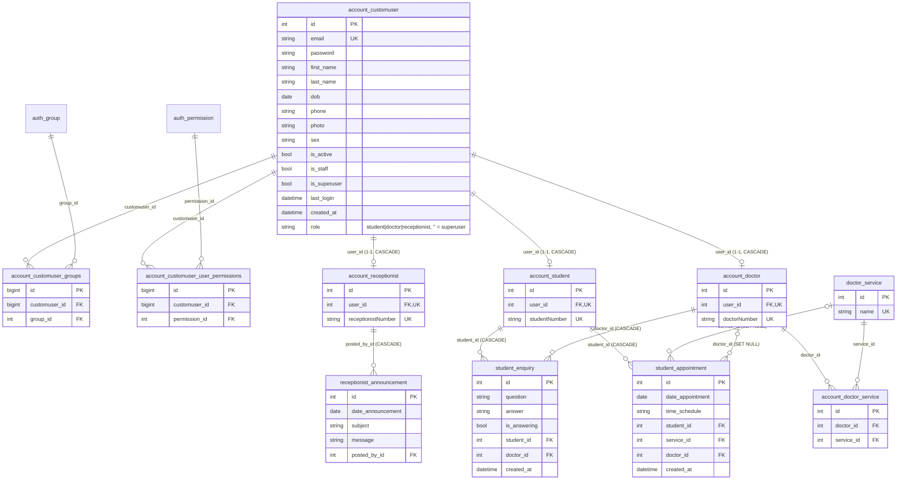

# CLAUDE.md — SAMS (Student Appointment Management System)

## Méthode : Junior
- Claude : **lecture seule** sur le code. Écriture autorisée uniquement sur `CLAUDE.md`, `tasks.md`, `docs.md`, `deploiement.md`.
- Gabriel code à la main selon les orientations ; Claude explique, relit, propose les tests et commandes.
- `docs.md` riche (code, comment, pourquoi), mis à jour après chaque point du plan.
- Cycle : Plan → Gabriel développe → Tester → Gabriel valide.
- Skills à charger : `bp-django`, `bp-database`, `bp-git-security`.

## Projet
Gestion des rendez-vous d'un service de santé étudiant : les étudiants prennent rendez-vous (service, médecin, créneau), les médecins gèrent leurs rendez-vous, la réception publie des annonces.

- Dépôt : https://github.com/gabrielbygas/sams (branche `main`)
- Stack : **Python 3.13 + Django 5.2 LTS** (support jusqu'à avril 2028), **MariaDB 10.11** (driver `mysqlclient`, `ENGINE = django.db.backends.mysql`), Pillow, templates Django.
- Dépendances : **uv** (`pyproject.toml` + `uv.lock` + `.python-version`). Dev : Ruff, pip-audit.
- Config : variables d'environnement dans `.env` (jamais commité), lues par `django-environ` ; modèle dans `.env.example`.
- Utilisateur DB : `djangouser`, droits limités aux bases `sams` et `test_sams`.
- Suite de la refonte : comptes et rôles (point 3), Docker, CI/CD GitHub Actions (voir `tasks.md`).
- Règle métier : **un utilisateur = un seul rôle** (étudiant, médecin ou réceptionniste) ; le superuser a accès à tout.

## Commandes
```bash
uv sync                                          # installer / recréer .venv à partir de uv.lock
uv run python manage.py runserver
uv run python -Wd manage.py check                # avec les avertissements de dépréciation
uv run python manage.py makemigrations --check --dry-run
uv run python manage.py migrate
uv run ruff check . --statistics                 # lint
uv run ruff format --check .                     # formatage (pas encore appliqué : début du point 3)
uv run pip-audit                                 # vulnérabilités connues des dépendances
uv add <paquet> / uv add --dev <outil> / uv remove <paquet>
```

## Structure actuelle
| Dossier | Rôle |
|---|---|
| `sams/` | projet (settings unique, urls, vues home) |
| `account/` | `CustomUser` (login par email) + profils `Student`, `Doctor`, `Receptionist` |
| `student/` | `Appointment`, `Enquiry` |
| `doctor/` | `Service` |
| `receptionist/` | `Announcement` |
| `templates/` | gabarits communs (`header.html`, `sidebar.html`…) |
| `sams/static/` | sources des fichiers statiques (suivies par Git) |
| `staticfiles/`, `mediafiles/` | statiques collectés (`collectstatic`), uploads — ignorés par Git |
| `.venv/` | virtualenv géré par uv — ignoré par Git |
| `.env` | secrets et config locale — ignoré par Git |

## Carte du code (pour s'y retrouver)
Gabriel reprend Django après 2 ans : Claude explique **niveau junior** (notion → mini-exemple → endroit précis dans SAMS → code avant/après), sans supposer connus les détails de Python ni de Django.

**Trajet d'une requête** : `sams/urls.py` (préfixe → app) → `<app>/urls.py` (adresse → vue, avec un `name`) → `<app>/views.py` (décorateurs `login_required` puis `user_passes_test` = contrôle d'accès, puis le travail) → `<app>/templates/<app>/*.html` (affichage).

| App | Préfixe | Namespace | Fonction de test d'accès | Qui entre |
|---|---|---|---|---|
| `account` | `/accounts/` | `accounts` | `is_superuser`, `is_superuser_or_receptionist` | login : tous ; créer médecin : réception + admin ; créer réceptionniste : admin |
| `student` | `/students/` | `students` | `can_access_student_space` | étudiants + réception + admin |
| `doctor` | `/doctors/` | `doctors` | `can_access_doctor_space` | médecins + réception + admin |
| `receptionist` | `/receptionists/` | `receptionists` | `is_receptionist` | réception + admin |

- **Rôle** : `CustomUser.role` (`TextChoices` : `student`, `doctor`, `receptionist`) ; `""` pour le superuser seulement (contrainte `role_required_unless_superuser`). Tester avec `user.has_role(Role.X, ...)` (superuser = toujours vrai). `is_student()`… restent pour les templates.
- **Profils** : `Student`, `Doctor`, `Receptionist` (1-1 avec `CustomUser`, numéro unique) ; `RoleProfileMixin.clean()` refuse un profil dont le compte n'a pas le bon rôle.
- **Pages d'erreur** : chaque app a `<app>_error_page` + l'URL `name="error-page"` ; c'est la cible des `login_url=` de `user_passes_test`.
- **Création de comptes** : `account/views.py` `create_user_view()` (générique, appelé par `create_student/doctor/receptionist`, arguments **nommés**).
- **Vues listes** : `get_queryset()` filtre selon le rôle (l'étudiant/le médecin voit les siens, la réception voit tout) ; réponse JSON si requête AJAX (`X-Requested-With`).

## MLD (schéma réel MariaDB après `migrate`, 2026-10-27 — 38 migrations appliquées, dernière : `account.0010`)


Contrainte CHECK : `role_required_unless_superuser` (`is_superuser = 1 OR role <> ''`). Contraintes uniques : `unique_appointment_per_student_per_day` (`date_appointment`, `student_id`) ; (`doctor_id`, `service_id`) sur la table M2M ; (`customuser_id`, `group_id`) et (`customuser_id`, `permission_id`) sur les tables de `PermissionsMixin`. `auth_group` et `auth_permission` sont les tables de `django.contrib.auth` (non détaillées).

## Contact
Gabriel KALALA 🇨🇩 — gabrielkalala@protonmail.com — https://gabrielkalala.com — https://github.com/gabrielbygas
