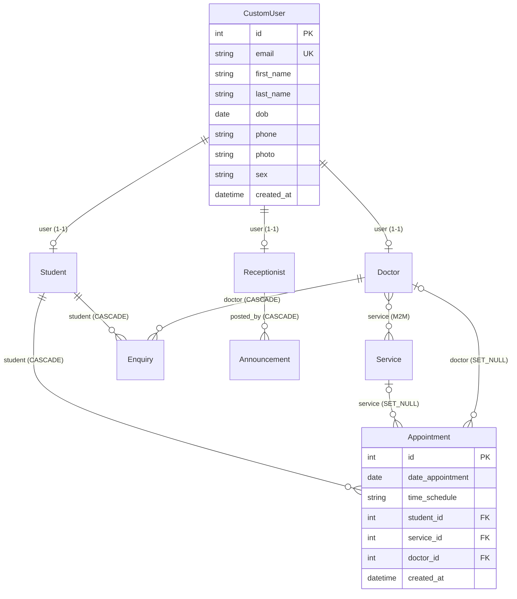

# CLAUDE.md — SAMS (Student Appointment Management System)

## Méthode : Junior
- Claude : **lecture seule** sur le code. Écriture autorisée uniquement sur `CLAUDE.md`, `tasks.md`, `docs.md`, `deploiement.md`.
- Gabriel code à la main selon les orientations ; Claude explique, relit, propose les tests et commandes.
- `docs.md` riche (code, comment, pourquoi), mis à jour après chaque point du plan.
- Cycle : Plan → Gabriel développe → Tester → Gabriel valide.
- Skills à charger : `bp-django`, `bp-database`, `bp-git-security`.

## Projet
Gestion des rendez-vous d'un service de santé étudiant : les étudiants prennent rendez-vous (service, médecin, créneau), les médecins gèrent leurs rendez-vous, la réception publie des annonces.

- Dépôt : https://github.com/gabrielbygas/sams (branche `main`)
- Stack actuelle : Django 5.0.3, MySQL (mysqlclient), Pillow, templates Django.
- Cible de la refonte : **Django 5.2 LTS** + Python 3.13, Docker, CI/CD GitHub Actions (voir `tasks.md`).

## Structure actuelle
| Dossier | Rôle |
|---|---|
| `sams/` | projet (settings unique, urls, vues home) |
| `account/` | `CustomUser` (login par email) + profils `Student`, `Doctor`, `Receptionist` |
| `student/` | `Appointment`, `Enquiry` |
| `doctor/` | `Service` |
| `receptionist/` | `Announcement` |
| `templates/`, `staticfiles/`, `mediafiles/` | gabarits, statiques collectés, uploads |
| `.env/` | ⚠️ c'est un **virtualenv**, pas un fichier de variables |

## MLD (d'après les `models.py` au 2026-10-26 — à confirmer après la 1re migration)

Contrainte : `unique_appointment_per_student_per_day` (`date_appointment`, `student`).

## Contact
Gabriel KALALA 🇨🇩 — gabrielkalala@protonmail.com — https://gabrielkalala.com — https://github.com/gabrielbygas
